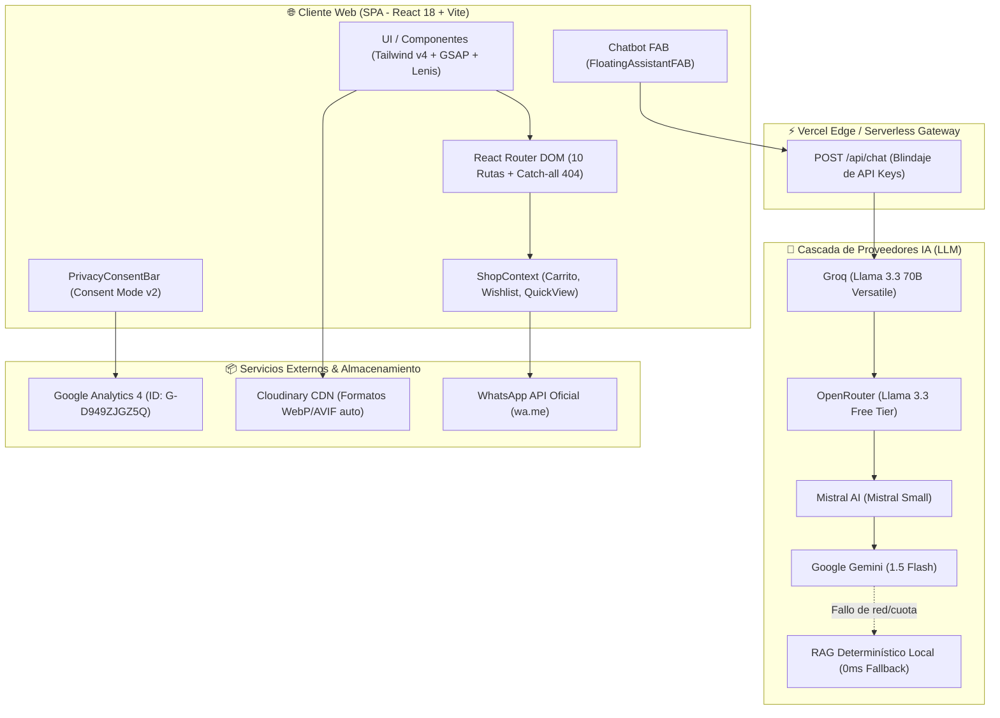
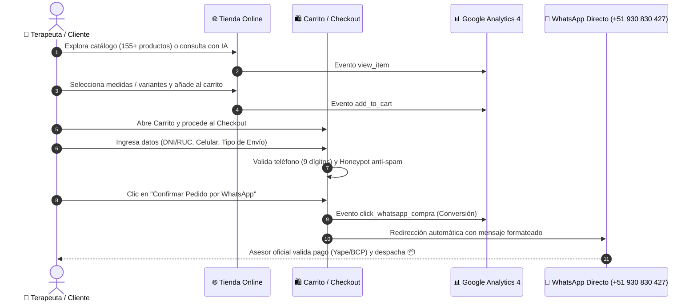
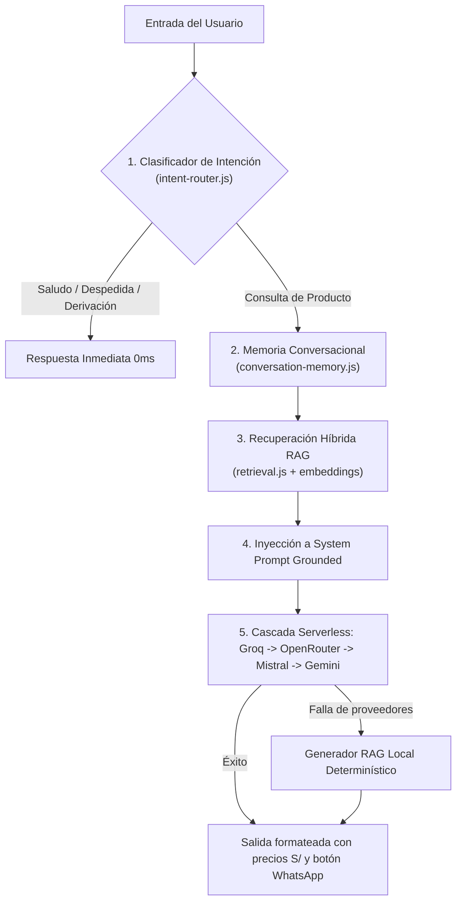

# 🪡 Agujas Acupuntura Perú — Plataforma E-commerce & Asistente Clínico IA

[](https://vitejs.dev/)
[](https://reactjs.org/)
[](https://tailwindcss.com/)
[](https://vercel.com/)
[](https://analytics.google.com/)
[](https://www.gob.pe/)

---

## 🏛️ 1. Descripción del Proyecto

**Agujas Acupuntura Perú** (`https://agujas-acupuntura-peru.vercel.app`) es una plataforma web de comercio electrónico de alta precisión desarrollada para el **Instituto de Terapias Integrales Perú**. Está especializada en el suministro de insumos médicos certificados, agujas de acupuntura estériles, conos y puros de moxibustión, ventosas terapéuticas, semillas de auriculoterapia y extractos amazónicos de la línea Amazoni-k en Lima y todo el territorio peruano.

---

## 🏗️ 2. Arquitectura Global del Sistema



---

## 🛒 3. Diagrama de Flujo de Usuario (E-commerce a WhatsApp)



---

## 🤖 4. Arquitectura del Asistente Clínico IA (RAG Cascada)

El chatbot interactivo implementa un pipeline de 5 fases para garantizar respuestas inmediatas, precisas y 100% fundamentadas en el catálogo de productos:



---

## 📱 5. Mapa de Rutas y Pantallas

| Ruta | Componente | Descripción |
| :--- | :--- | :--- |
| `/` | `HomePage.jsx` | Hero slider, categorías visuales, vitrina top 10, masterclasses y testimonios. |
| `/productos` | `ProductsPage.jsx` | Catálogo completo (155 productos) con filtros por categoría, marca, precio y buscador. |
| `/videos` | `VideosPage.jsx` | Galería de videos demostrativos de uso clínico de insumos. |
| `/aceites-amazonik` | `AmazonikPage.jsx` | Sección dedicada a aceites amazónicos 100% puros (Copaiba, Sangre de Grado, Palo Santo). |
| `/tutoriales` | `TutorialsPage.jsx` | Guías y artículos formativos para terapeutas y estudiantes. |
| `/sobre-nosotros` | `AboutUsPage.jsx` | Historia institucional, sede en Lince, mapa interactivo y libro de reclamaciones. |
| `/checkout` | `CheckoutPage.jsx` | Formulario de pago, selección de despacho (Lima/Provincia), cálculo de envío y cupones. |
| `/politica-privacidad`| `PrivacyPolicyPage.jsx`| Cumplimiento legal Ley N.° 29733 y ejercicio de Derechos ARCO. |
| `/terminos-y-condiciones`| `TermsPage.jsx`| Condiciones comerciales, garantías y políticas de devolución. |
| `*` | `NotFoundPage.jsx` | Error 404 personalizado con buscador integrado y accesos rápidos. |

---

## 💳 6. Medios de Pago Oficiales

Todas las transacciones se realizan directamente con las cuentas oficiales de la institución:

* **Titular Único:** `Instituto de terapias integrales Perú`
* **Yape:** `939 371 250`
* **Transferencia Bancaria BCP Soles:**
  * **Número de Cuenta:** `1932597886070`
  * **Código de Cuenta Interbancario (CCI):** `00219300259788607015`
* **Atención y Envíos WhatsApp:** `+51 930 830 427`

---

## 🔒 7. Seguridad, SEO y Cumplimiento Normativo

* **Blindaje Serverless de API Keys:** La carpeta `api/chat.js` aísla las claves de IA en el entorno backend de Vercel.
* **Seguridad HTTP:** Cabeceras HSTS pre-activadas (`max-age=63072000`), `X-Frame-Options: SAMEORIGIN` y `X-Content-Type-Options: nosniff`.
* **Google Consent Mode v2:** Cumplimiento estricto con la Ley N.° 29733 de Protección de Datos Personales del Perú mediante `PrivacyConsentBar.jsx`.
* **Sitemap Automatizado:** Script `scripts/generate-sitemap.js` genera `sitemap.xml` con 155 productos en cada compilación.
* **Anti-SPAM:** Trampa Honeypot invisible en Checkout que frena envíos masivos automatizados.

---

## 💻 8. Guía de Desarrollo Local

### Prerrequisitos
* Node.js v18 o superior
* npm v9 o superior

### Instalación
```bash
# 1. Clonar el repositorio
git clone https://github.com/Alessander9/AgujasAcupunturaPeru.git
cd AgujasAcupunturaPeru

# 2. Instalar dependencias
npm install

# 3. Iniciar el servidor de desarrollo
npm run dev
```

### Variables de Entorno (`.env`)
```env
# Claves de IA para el Asistente Clínico
GROQ_API_KEY=tu_clave_de_groq
OPENROUTER_API_KEY=tu_clave_de_openrouter
GEMINI_API_KEY=tu_clave_de_gemini
MISTRAL_API_KEY=tu_clave_de_mistral

# Cloudinary
VITE_CLOUDINARY_CLOUD_NAME=agujas-acupuntura-peru
```

### Construcción para Producción
```bash
# Genera el sitemap dinámico y compila el bundle optimizado
npm run build
```

---

## 🏢 9. Créditos y Titularidad

* **Entidad:** Instituto de Terapias Integrales Perú
* **Dirección:** Av. Julio César Tello 438, Lince 15046, Lima - Perú
* **Dominio Oficial:** [https://agujas-acupuntura-peru.vercel.app](https://agujas-acupuntura-peru.vercel.app)
* **Año:** 2026
