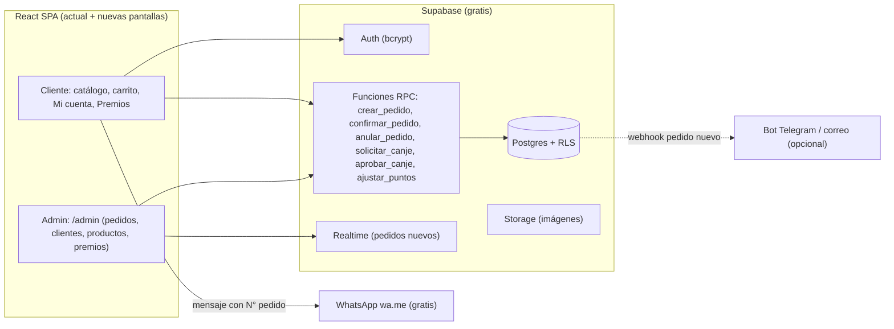

# Auditoría del proyecto vs. Requerimientos "Sistema de puntos y pedidos"

**Proyecto:** Agujas Acupuntura Perú (`agujas-acupuntura-react`)
**Fecha de auditoría:** 13/11/2026
**Alcance:** comparar el código actual con los requerimientos RF-01…RF-24 y RNF-01…RNF-05, y definir el plan más óptimo (bajo costo + mínima complejidad) para completar lo que falta.

---

## 1. Resumen ejecutivo

El proyecto actual es una **tienda-catálogo estática** (SPA React 18 + Vite + Tailwind, desplegada en Vercel) muy completa a nivel visual: 157 productos, carrito, favoritos, checkout con formulario, SEO, GA4 y un chatbot IA. **Pero no tiene backend de datos**: no hay base de datos, ni usuarios, ni login, ni pedidos guardados, ni panel de administración.

| Área | Estado |
|---|---|
| Catálogo y carrito (lado cliente) | ✅ Hecho |
| Pedido enviado por WhatsApp | 🟡 Parcial (no se guarda en ningún lado) |
| Cuentas de cliente / login | ❌ No existe |
| Pedidos persistentes con estados | ❌ No existe |
| Puntos, movimientos, canjes | ❌ No existe |
| Panel de administrador | ❌ No existe |
| Productos editables sin tocar código | ❌ Hoy se editan en `productsData.js` + commit |

> **Conclusión:** aproximadamente el **80 % del alcance funcional del sistema de puntos está pendiente**. Lo bueno: el frontend (catálogo, carrito, checkout, diseño responsive) se reutiliza casi completo; lo que falta es **una base de datos con autenticación y un panel admin**.

### Cómo es la app hoy (verificado en el código)

- Rutas: [App.jsx](file:///c:/Users/Alessander/Desktop/TRABAJOS/ACTUALES/AgujasAcupunturaNUEVO/src/App.jsx) → solo páginas públicas (inicio, productos, checkout, tutoriales, videos, legales). No hay `/login`, `/mi-cuenta` ni `/admin`.
- Estado: [ShopContext.jsx](file:///c:/Users/Alessander/Desktop/TRABAJOS/ACTUALES/AgujasAcupunturaNUEVO/src/context/ShopContext.jsx) guarda carrito y favoritos en `localStorage`.
- Catálogo: [productsData.js](file:///c:/Users/Alessander/Desktop/TRABAJOS/ACTUALES/AgujasAcupunturaNUEVO/src/data/productsData.js) (352 KB, 157 productos, array estático).
- Pedido: [CheckoutPage.jsx](file:///c:/Users/Alessander/Desktop/TRABAJOS/ACTUALES/AgujasAcupunturaNUEVO/src/pages/CheckoutPage.jsx#L141-L237) genera un número `AAP-xxxxxx` **aleatorio en el navegador** y abre `wa.me` con el mensaje. Nada se persiste; si el cliente no pulsa "enviar" en WhatsApp, el pedido se pierde.
- Backend: solo existe [api/chat.js](file:///c:/Users/Alessander/Desktop/TRABAJOS/ACTUALES/AgujasAcupunturaNUEVO/api/chat.js) (función serverless del chatbot).

---

## 2. Matriz de cumplimiento

Leyenda: ✅ Cumple · 🟡 Parcial · ❌ No existe

### 2.1 Requerimientos funcionales

| ID | Requerimiento | Estado | Observación |
|---|---|---|---|
| RF-01 | Registro y acceso de clientes | ❌ | No hay autenticación. |
| RF-02 | Espacio propio (nombre, historial, saldo) | ❌ | No hay página "Mi cuenta". |
| RF-03 | Cliente solo ve su info | ❌ | No hay datos por usuario. |
| RF-04 | Admin crea/edita/activa/desactiva productos | 🟡 | Los productos existen (nombre, descripción, precio, imagen, `enStock`) pero son código estático; requiere desarrollador + deploy. |
| RF-05 | Valor en puntos por producto | ❌ | No existe el campo `puntos`. |
| RF-06 | Ver catálogo y elegir cantidades | ✅ | Carrito con `updateQuantity`. |
| RF-07 | Armar pedido con varios productos y enviarlo | 🟡 | Se arma, pero solo se envía como texto de WhatsApp. |
| RF-08 | Pedido llega al admin (panel/notificación) | 🟡 | Llega por WhatsApp desde el celular del cliente; no hay panel. |
| RF-09 | Estados Pendiente → Confirmado → Entregado / Rechazado | ❌ | Sin persistencia, no hay estados. |
| RF-10 | Sin pasarela de pago | ✅ | Pago fuera de la web (Yape/BCP/transferencia). |
| RF-11 | Admin confirma manualmente la venta | ❌ | |
| RF-12 | Suma automática de puntos al confirmar | ❌ | |
| RF-13 | Puntos una sola vez por pedido | ❌ | |
| RF-14 | Anular pedido confirmado revierte puntos | ❌ | |
| RF-15 | Historial de movimientos de puntos | ❌ | |
| RF-16 | Catálogo de ~10 premios | ❌ | |
| RF-17 | Costo en puntos por premio | ❌ | |
| RF-18 | Cliente solicita canje con saldo suficiente | ❌ | |
| RF-19 | Admin aprueba canje y se descuentan puntos | ❌ | |
| RF-20 | Productos caros fuera del canje | ❌ | |
| RF-21 | Lista de pedidos filtrable por estado | ❌ | |
| RF-22 | Gestión de clientes, saldo e historial | ❌ | |
| RF-23 | Configurar tarifario y premios | ❌ | |
| RF-24 | Ajuste manual de puntos con motivo | ❌ | |

### 2.2 Requerimientos no funcionales

| ID | Requerimiento | Estado | Observación |
|---|---|---|---|
| RNF-01 | Bajo costo | 🟡 | Vercel gratis, pero el plan **Hobby de Vercel prohíbe uso comercial** (ver §6). |
| RNF-02 | Simple y responsive | ✅ | Diseño mobile-first ya trabajado. |
| RNF-03 | Seguridad (contraseñas cifradas, roles) | ❌ | No hay usuarios. Además hay una **clave API expuesta** (ver §3). |
| RNF-04 | Trazabilidad de puntos (fecha y responsable) | ❌ | |
| RNF-05 | Agregar productos/premios sin cambiar código | ❌ | Hoy todo cambio de catálogo es un commit. |

### 2.3 Modelo de datos

Ninguna de las 6 entidades (Cliente, Producto, Premio, Pedido, Detalle, Movimiento) existe como datos persistentes. Solo "Producto" existe, como archivo JS.

---

## 3. Hallazgos críticos encontrados durante la auditoría (resolver ANTES)

> [!CAUTION]
> **La clave de Groq está publicada en el JavaScript de producción.** Se encontró un valor `gsk_…` dentro de `dist/assets/index-*.js`. Ocurre porque [aiService.js](file:///c:/Users/Alessander/Desktop/TRABAJOS/ACTUALES/AgujasAcupunturaNUEVO/src/lib/aiService.js#L52-L164) lee `import.meta.env.VITE_GROQ_API_KEY` (y OpenRouter, Mistral, Gemini) en el navegador: **todo lo que tenga prefijo `VITE_` y se use en el frontend se incrusta en el bundle público.**

**Qué hacer:**
1. Revocar/rotar inmediatamente las claves de Groq, OpenRouter, Mistral y Gemini.
2. Eliminar el *fallback* directo a proveedores en `aiService.js`; el navegador debe llamar **solo** a `/api/chat`.
3. En Vercel, definir las claves **sin** prefijo `VITE_` (`GROQ_API_KEY`, etc.) y quitar el fallback `process.env.VITE_*` de `api/chat.js`.
4. Quitar `VITE_CLOUDINARY_API_SECRET` del `.env`: un *secret* nunca debe llevar prefijo `VITE_`.

Otros hallazgos menores:

| Hallazgo | Riesgo | Acción |
|---|---|---|
| Número de pedido aleatorio en el cliente (`Math.random`) | Puede duplicarse; no sirve como referencia real | Lo generará la base de datos (secuencia). |
| Cupones hardcodeados en el frontend (`ACUPUNTURA10`, `ENVIOFREE`) | Cualquiera los ve en el código fuente | Aceptable hoy; moverlos a tabla `settings` si se quiere controlarlos. |
| `Access-Control-Allow-Origin: *` en `api/chat.js` | Terceros pueden consumir tu cuota de IA | Restringir al dominio propio. |
| Archivos duplicados/pesados: `src/lib/embeddings.json` y `src/data/embeddings.json` (4,6 MB c/u), `products.json` ≈ `productos_completos.json`, `dorpdown-navigation.tsx`, `product-card.tsx` vacíos | Repo pesado, confusión | Limpiar en una tarea aparte. |

---

## 4. Arquitectura recomendada (la más óptima para este caso)

### 4.1 Decisión: **Supabase (plan gratuito) + el frontend React actual**

Se descartan alternativas por costo o complejidad:

| Opción | Por qué NO / por qué SÍ |
|---|---|
| Backend propio (Node/Express + VPS) | Más código, más mantenimiento, servidor que pagar y parchear. ❌ |
| Firebase | Viable, pero las reglas de NoSQL hacen más difícil garantizar la consistencia de los puntos (transacciones, conteos). 🟡 |
| WordPress + WooCommerce + plugin de puntos | Reescribir todo el frontend y pagar plugins. ❌ |
| **Supabase** | Postgres real + Auth (contraseñas con bcrypt) + Row Level Security + Storage + Realtime, **gratis** hasta 500 MB de BD y 50 000 usuarios activos/mes. Se llama directo desde React con `@supabase/supabase-js`; **no hace falta escribir una API**. ✅ |

**Principio clave del diseño:** toda la lógica de puntos vive **dentro de la base de datos** en funciones SQL transaccionales (RPC). El frontend nunca suma ni resta puntos; solo llama `confirmar_pedido(id)`, `aprobar_canje(id)`, etc. Así se cumplen RF-12, RF-13, RF-14, RF-19 y RNF-04 de forma segura, aunque alguien manipule el navegador.



### 4.2 Decisiones sobre los "Pendientes por definir" (recomendación)

| Pendiente | Recomendación óptima | Motivo |
|---|---|---|
| Identificador del cliente | **Celular + contraseña** | Es lo que el cliente peruano usa y ya se pide en el checkout. Login por SMS (OTP) cuesta dinero por mensaje, se evita. Técnicamente: Supabase Auth con correo interno sintético `51XXXXXXXXX@clientes.agujasacupunturaperu.com` y confirmación de correo desactivada. El DNI se guarda como dato, no como login. |
| Recuperar contraseña | El admin la resetea desde el panel (función protegida) y se la envía por WhatsApp | Cero costo, sin servicio de correo. Si luego se agrega correo real, se habilita "olvidé mi contraseña" estándar. |
| ¿Los puntos vencen? | **No vencen en la v1** (dejar el campo preparado en `settings`) | Vencimiento requiere un job programado y reglas FIFO: complejidad innecesaria al inicio. |
| Canal de notificación | **Panel con aviso en tiempo real + WhatsApp del cliente (ya existe)**; opcional **bot de Telegram** | Telegram es push instantáneo y 100 % gratis. La API oficial de WhatsApp Business cobra por conversación y exige verificación de Meta: se descarta. |
| Tarifario y premios | Se cargan desde el panel admin; no bloquean el desarrollo | Arrancar con `puntos = 0` en todos y que el admin los llene. |
| Puntos tras anulación con saldo ya gastado | Permitir **saldo negativo** y bloquear canjes hasta que vuelva a ser ≥ 0 | Es la regla más simple que no pierde trazabilidad. |

---

## 5. Lo que falta hacer, paso a paso

### Fase 0 — Seguridad e higiene (½ día)
- [ ] Rotar claves de IA y eliminar el fallback del navegador (§3).
- [ ] Restringir CORS de `api/chat.js`.
- [ ] Crear proyecto en Supabase (región `sa-east-1` São Paulo, la más cercana a Lima).
- [ ] Instalar `@supabase/supabase-js`; agregar `VITE_SUPABASE_URL` y `VITE_SUPABASE_ANON_KEY` (la *anon key* sí es pública por diseño; la seguridad la da RLS). **Nunca** usar la `service_role` en el frontend.

### Fase 1 — Base de datos (1–2 días)

Crear las tablas en una migración SQL (`supabase/migrations/001_init.sql`). Esquema mínimo que cubre la sección 5 de los requerimientos:

```sql
-- Perfiles (1:1 con auth.users)
create table profiles (
  id uuid primary key references auth.users on delete cascade,
  nombre text not null,
  celular text unique not null,
  dni text,
  rol text not null default 'cliente' check (rol in ('cliente','admin')),
  puntos int not null default 0,          -- saldo cacheado; la verdad está en point_movements
  created_at timestamptz default now()
);

create table products (
  id text primary key,                     -- se conservan los ids actuales 'prod-159'
  slug text unique not null,
  nombre text not null,
  descripcion text,
  precio numeric(10,2) not null,
  puntos int not null default 0 check (puntos >= 0),   -- RF-05 tarifario
  imagen_url text,
  categoria text,
  activo boolean not null default true,   -- RF-04
  extra jsonb default '{}'::jsonb,        -- highlights, features, bloques… (lo que hoy está en productsData)
  updated_at timestamptz default now()
);

create table rewards (                     -- RF-16/17
  id bigint generated always as identity primary key,
  product_id text not null references products(id),
  costo_puntos int not null check (costo_puntos > 0),
  activo boolean not null default true
);

create type estado_pedido as enum ('pendiente','confirmado','entregado','rechazado','anulado');

create table orders (
  id bigint generated always as identity primary key,  -- N° de pedido real y único
  cliente_id uuid not null references profiles(id),
  estado estado_pedido not null default 'pendiente',
  total_soles numeric(10,2) not null,
  total_puntos int not null,
  datos_envio jsonb,                      -- dirección, comprobante, método de pago, notas
  confirmado_por uuid references profiles(id),
  confirmado_at timestamptz,
  created_at timestamptz default now()
);

create table order_items (
  order_id bigint references orders(id) on delete cascade,
  product_id text references products(id),
  cantidad int not null check (cantidad > 0),
  precio_unit numeric(10,2) not null,     -- snapshot: si luego cambia el precio, el pedido no cambia
  puntos_unit int not null,               -- snapshot del tarifario
  primary key (order_id, product_id)
);

create type estado_canje as enum ('pendiente','aprobado','rechazado','entregado');

create table redemptions (
  id bigint generated always as identity primary key,
  cliente_id uuid not null references profiles(id),
  reward_id bigint not null references rewards(id),
  costo_puntos int not null,
  estado estado_canje not null default 'pendiente',
  resuelto_por uuid references profiles(id),
  created_at timestamptz default now()
);

create type tipo_mov as enum ('suma','reversion','canje','ajuste');

create table point_movements (             -- RF-15 / RNF-04 (solo inserciones, nunca update/delete)
  id bigint generated always as identity primary key,
  cliente_id uuid not null references profiles(id),
  tipo tipo_mov not null,
  cantidad int not null,                  -- positivo suma, negativo resta
  saldo_resultante int not null,
  ref_tipo text,                          -- 'order' | 'redemption' | null
  ref_id bigint,
  motivo text,
  creado_por uuid references profiles(id), -- responsable
  created_at timestamptz default now()
);

-- RF-13: imposibilidad física de acreditar dos veces el mismo pedido
create unique index uq_mov_por_ref on point_movements (ref_tipo, ref_id, tipo)
  where ref_tipo is not null;

create table settings (key text primary key, value jsonb);  -- p.ej. umbral de precio para premios, vencimiento
```

**Por qué así:**
- `point_movements` es el **libro contable** (append-only). `profiles.puntos` es solo un caché que se actualiza en la misma transacción → lectura rápida sin sumar todo el historial.
- El **índice único** garantiza RF-13 a nivel de BD: aunque el admin haga doble clic o haya dos pestañas, el segundo intento falla.
- Los *snapshots* en `order_items` hacen que cambiar el tarifario no altere pedidos ya confirmados.

### Fase 2 — Lógica de negocio en funciones SQL (1–2 días)

Todas como `security definer`, validando rol con un helper `is_admin()`. Cada una corre en **una sola transacción** con `select … for update` para evitar condiciones de carrera.

| Función | Quién | Qué hace | Requerimientos |
|---|---|---|---|
| `crear_pedido(items jsonb, datos_envio jsonb)` | Cliente | Lee precio y puntos **desde `products`** (no confía en el navegador), valida `activo`, inserta pedido + detalle en estado `pendiente`, devuelve el N° | RF-07, RF-09 |
| `confirmar_pedido(order_id)` | Admin | Bloquea el pedido; si no está `pendiente` → error. Cambia a `confirmado`, inserta movimiento `suma` (= Σ puntos_unit × cantidad) y actualiza saldo | RF-11, RF-12, RF-13 |
| `cambiar_estado_pedido(order_id, estado)` | Admin | `confirmado → entregado`, `pendiente → rechazado` | RF-09 |
| `anular_pedido(order_id, motivo)` | Admin | Si estaba `confirmado`: movimiento `reversion` negativo + saldo. Pasa a `anulado` | RF-14 |
| `solicitar_canje(reward_id)` | Cliente | Verifica premio activo y que `saldo − canjes pendientes ≥ costo`. Inserta canje `pendiente` (aún no descuenta) | RF-18 |
| `aprobar_canje(id)` / `rechazar_canje(id)` | Admin | Bloquea el perfil, revalida saldo, inserta movimiento `canje` negativo | RF-19 |
| `ajustar_puntos(cliente_id, cantidad, motivo)` | Admin | `motivo` obligatorio (`not null` y no vacío); movimiento `ajuste` | RF-24, RNF-04 |
| `admin_reset_password(cliente_id, nueva)` | Admin | Vía función serverless con `service_role` (única que la necesita) | RF-01 |

Ejemplo del núcleo (confirmación):

```sql
create or replace function confirmar_pedido(p_order bigint)
returns void language plpgsql security definer set search_path = public as $$
declare v orders; v_pts int; v_saldo int;
begin
  if not is_admin() then raise exception 'No autorizado'; end if;

  select * into v from orders where id = p_order for update;
  if v.estado <> 'pendiente' then raise exception 'El pedido no está pendiente'; end if;

  select coalesce(sum(cantidad * puntos_unit),0) into v_pts from order_items where order_id = p_order;

  update orders set estado='confirmado', total_puntos=v_pts,
         confirmado_por=auth.uid(), confirmado_at=now() where id = p_order;

  update profiles set puntos = puntos + v_pts where id = v.cliente_id
  returning puntos into v_saldo;

  insert into point_movements(cliente_id,tipo,cantidad,saldo_resultante,ref_tipo,ref_id,creado_por)
  values (v.cliente_id,'suma',v_pts,v_saldo,'order',p_order,auth.uid());
end $$;
```

**RF-20 (productos caros fuera del canje):** el catálogo de premios es una tabla curada por el admin, así que ya está controlado. Como refuerzo, un *trigger* en `rewards` que rechace productos con `precio > settings.precio_max_premio` (p. ej. S/ 30).

### Fase 3 — Seguridad con Row Level Security (½ día)

```sql
alter table profiles enable row level security;   -- (igual en todas las tablas)

create policy "ve su perfil"   on profiles for select using (id = auth.uid() or is_admin());
create policy "ve sus pedidos" on orders   for select using (cliente_id = auth.uid() or is_admin());
create policy "ve sus movs"    on point_movements for select using (cliente_id = auth.uid() or is_admin());
create policy "catálogo público" on products for select using (activo or is_admin());
create policy "admin edita productos" on products for all using (is_admin()) with check (is_admin());
-- Sin políticas de insert/update sobre orders, point_movements, redemptions:
-- solo se escriben a través de las funciones RPC.
```

- Cliente solo puede editar `nombre` de su perfil (*column grant* o *trigger* que impida cambiar `rol` y `puntos`). Esto evita la escalada de privilegios más común.
- El primer admin se marca manualmente en el panel de Supabase (`update profiles set rol='admin' …`).
- Cumple RF-03 y RNF-03 (las contraseñas las cifra Supabase Auth con bcrypt).

### Fase 4 — Migrar el catálogo a la BD (1 día)

- [ ] Script `scripts/seed-products.js` que lee `PRODUCTS_CATALOG` y hace *upsert* en `products` (campos principales en columnas, el resto en `extra`). Conservar los `id` actuales para no romper favoritos/carritos en `localStorage`.
- [ ] Imágenes: mantener las rutas actuales de `/img_productos/` para lo existente; las **nuevas** se suben desde el panel a **Supabase Storage** (1 GB gratis) o Cloudinary (ya configurado).
- [ ] Hook `useProducts()` que lee de Supabase y cachea en memoria/`sessionStorage`. Reemplaza los imports de `PRODUCTS_CATALOG` en `ShopContext`, `ProductsPage`, `FeaturedProducts`, `QuickViewModal`, etc.
- [ ] **SEO y chatbot** dependen del archivo estático (sitemap, RAG/embeddings). Solución simple: en `npm run build`, un script exporta `products` desde Supabase a JSON → el sitemap y el RAG siguen funcionando igual. Un *Deploy Hook* de Vercel se puede disparar desde el panel tras editar productos ("Publicar cambios").

> [!TIP]
> Si se quiere reducir riesgo, la Fase 4 puede hacerse **al final**: al inicio basta con una tabla `products` que tenga `id`, `precio`, `puntos` y `activo` (sembrada desde el JS actual) para que los pedidos funcionen, y migrar el contenido completo después.

### Fase 5 — Pantallas del cliente (2–3 días)

| Ruta / componente | Contenido | Req. |
|---|---|---|
| `AuthContext` | Sesión de Supabase, perfil y rol; `RequireAuth` / `RequireAdmin` | RF-01, RNF-03 |
| `/registro`, `/ingresar` | Nombre, celular (9 dígitos, inicia con 9 — validación ya existe en checkout), DNI opcional, contraseña | RF-01 |
| Header | Ícono de usuario + chip "⭐ 120 pts" cuando hay sesión | RF-02 |
| `ProductCard` / `QuickViewModal` | Badge "+10 pts" por producto | RF-05 |
| `CheckoutPage` (modificar) | Exigir sesión (o login en el mismo paso), prellenar datos del perfil, llamar `crear_pedido`, mostrar N° real y **luego** abrir WhatsApp con ese N° y "Puntos a ganar: X" | RF-07, RF-08 |
| `/mi-cuenta` | Saldo, pedidos con estado, historial de movimientos | RF-02, RF-15 |
| `/premios` | Grilla de premios con costo; botón "Canjear" deshabilitado si no alcanza; estado de canjes | RF-16…RF-18 |

### Fase 6 — Panel de administrador (3–4 días)

Ruta `/admin` cargada con `React.lazy` (no pesa para los clientes). Reutilizar el sistema de diseño Tailwind existente; tablas simples, botones grandes (usable desde celular).

| Pantalla | Funciones | Req. |
|---|---|---|
| **Pedidos** | Pestañas por estado (Pendiente / Confirmado / Entregado / Rechazado / Anulado), detalle, botones Confirmar · Rechazar · Entregado · Anular (con motivo). Badge en tiempo real con **Supabase Realtime** + sonido al entrar un pedido | RF-08, RF-09, RF-11, RF-14, RF-21 |
| **Clientes** | Buscador por nombre/celular, saldo, pedidos, movimientos, "Ajustar puntos" (motivo obligatorio), "Resetear contraseña" | RF-22, RF-24 |
| **Productos** | Tabla con edición en línea de precio y **puntos** (tarifario), toggle activo, formulario crear/editar con subida de imagen | RF-04, RF-05, RF-23 |
| **Premios** | Elegir producto, costo en puntos, activo | RF-16, RF-17, RF-20, RF-23 |
| **Canjes** | Pendientes → Aprobar / Rechazar / Entregado | RF-19 |

### Fase 7 — Notificaciones (½ día, opcional)

1. **Ya gratis:** panel con aviso en tiempo real + el WhatsApp que envía el cliente, ahora con N° de pedido real.
2. **Recomendado (gratis):** *Database Webhook* de Supabase en `insert` sobre `orders` → función `api/notify.js` en Vercel → **bot de Telegram** al celular del admin. Push instantáneo, sin costo.
3. Alternativa por correo: la misma función usando Resend (3 000 correos/mes gratis).

### Fase 8 — Pruebas y puesta en marcha (1 día)

Casos mínimos a verificar (pueden ser scripts SQL o pruebas manuales documentadas):
- [ ] Confirmar el mismo pedido dos veces (doble clic / dos pestañas) → solo **una** suma.
- [ ] Anular pedido confirmado → reversión exacta y movimiento registrado.
- [ ] Cliente A no puede leer pedidos/movimientos de B (probar con la API directamente, no solo la UI).
- [ ] Cliente no puede llamar `confirmar_pedido`, `ajustar_puntos` ni cambiar su `rol`/`puntos`.
- [ ] Canje sin saldo suficiente → rechazado; dos canjes simultáneos no dejan saldo negativo.
- [ ] Manipular precio/puntos en el navegador antes de `crear_pedido` → se ignoran (se toman de la BD).
- [ ] Flujo completo en celular (375 px).

---

## 6. Costos estimados

| Servicio | Plan | Costo |
|---|---|---|
| Supabase | Free (500 MB BD, 1 GB Storage, 50k MAU) | **S/ 0** |
| Hosting frontend | Vercel Hobby **o** Cloudflare Pages | **S/ 0** |
| Telegram bot / wa.me | — | **S/ 0** |
| Dominio | Ya existente | — |

> [!WARNING]
> - **Vercel Hobby no permite uso comercial** según sus términos. Para cumplir sin pagar, migrar el frontend a **Cloudflare Pages** (gratis y permite uso comercial; la función `api/chat.js` pasa a Pages Functions con cambios mínimos) o pasar a Vercel Pro (US\$ 20/mes).
> - **Supabase Free pausa el proyecto tras 7 días sin actividad.** Con tráfico real no ocurre; como seguro, un ping semanal (GitHub Actions gratis) o subir a Pro (US\$ 25/mes) cuando el negocio lo justifique.
> - Hacer respaldo semanal: `pg_dump` vía GitHub Actions a un repositorio privado (el plan Free no incluye backups descargables con retención).

---

## 7. Cronograma resumido

| Fase | Tarea | Esfuerzo |
|---|---|---|
| 0 | Seguridad (claves) + setup Supabase | 0,5 d |
| 1 | Esquema de BD | 1–2 d |
| 2 | Funciones RPC de puntos/pedidos/canjes | 1–2 d |
| 3 | RLS y roles | 0,5 d |
| 4 | Migración del catálogo | 1 d |
| 5 | Pantallas cliente | 2–3 d |
| 6 | Panel admin | 3–4 d |
| 7 | Notificaciones | 0,5 d |
| 8 | Pruebas y despliegue | 1 d |
| | **Total** | **≈ 11–15 días de desarrollo** |

**Orden recomendado para entregar valor rápido (MVP en ~1 semana):** Fase 0 → 1 → 2 → 3 → login + checkout guardando pedido + panel de pedidos con "Confirmar" + "Mi cuenta" con puntos. Luego premios/canjes, gestión de productos desde el panel y notificaciones.

---

## 8. Decisiones que debe confirmar el cliente

1. ¿Identificación por **celular + contraseña** (recomendado) o por correo?
2. Tarifario inicial de puntos por producto y costo de los ~10 premios (se pueden cargar después desde el panel).
3. Lista final de premios (falta aclarar el producto del audio).
4. ¿Los puntos vencen? (recomendado: no en la v1).
5. Canal de aviso de pedidos: ¿panel + WhatsApp basta, o se agrega Telegram/correo?
6. ¿Comprar sin cuenta sigue permitido (sin puntos), o el pedido exige registro? (recomendado: permitir ambos; solo los pedidos con cuenta acumulan puntos).
7. ¿Migrar hosting a Cloudflare Pages o pagar Vercel Pro?
