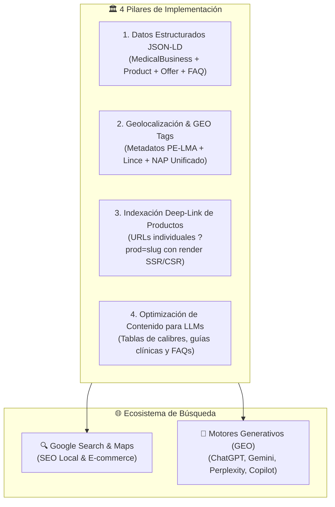
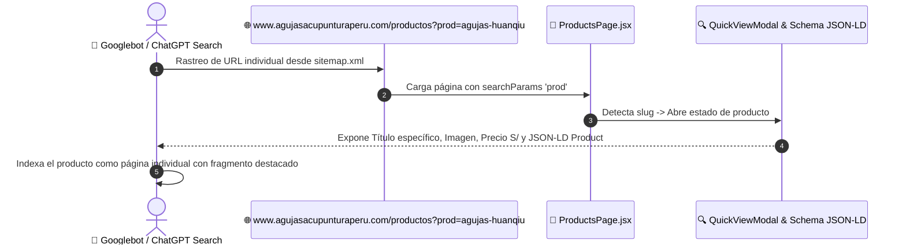

# 🚀 Plan de Implementación Integral: SEO Técnico, SEO Local & GEO
**Proyecto:** Agujas Acupuntura Perú (`www.agujasacupunturaperu.com`)  
**Objetivo:** Dominar los primeros resultados en Google Search / Google Maps y posicionar la tienda como la fuente primaria de recomendación para motores de IA (ChatGPT, Gemini, Perplexity, Copilot).

---

## 🏗️ Resumen de Estrategia: La Fusión de SEO + GEO



---

## 📋 Fase 1: Datos Estructurados Schema.org (GEO & Rich Snippets)

> **Objetivo GEO:** Que ChatGPT, Gemini y Perplexity reconozcan a la tienda como una entidad médica y comercial real con ubicación física en Lince y extraigan precios oficiales en tiempo real.

### 1.1 Inyección de Schema `MedicalBusiness` / `Store` Global
* **Ubicación:** `index.html` y componente `SEOHead.jsx`.
* **Propiedades obligatorias:**
  * `@type`: `["Store", "MedicalSupplyStore", "LocalBusiness"]`
  * `name`: "Agujas Acupuntura Perú - Instituto de Terapias Integrales"
  * `image`: `https://www.agujasacupunturaperu.com/agujaslogo.png`
  * `telephone`: `+51 930 830 427`
  * `priceRange`: "S/ 10 - S/ 350"
  * `address`:
    * `streetAddress`: "Av. Julio César Tello 438"
    * `addressLocality`: "Lince"
    * `addressRegion`: "Lima"
    * `postalCode`: "15046"
    * `addressCountry`: "PE"
  * `geo`: Latitud `-12.0833`, Longitud `-77.0333`
  * `openingHoursSpecification`: Lunes a Sábado.

### 1.2 Inyección dinámica de Schema `Product` en cada ítem
* **Ubicación:** Modal de producto (`QuickViewModal.jsx`) y `ProductsPage.jsx`.
* Cada producto inyectará dinámicamente en el DOM:
  * `name`: Nombre comercial exacto.
  * `description`: Medidas, especificaciones de esterilidad y usos.
  * `sku`: `PROD-XXX`
  * `brand`: "Huanqiu", "Wujiang Shenli", "Amazoni-k", etc.
  * `offers`:
    * `priceCurrency`: "PEN"
    * `price`: Precio numérico (ej. `25.00`)
    * `availability`: `https://schema.org/InStock`
    * `itemCondition`: `https://schema.org/NewCondition`
    * `seller`: "Instituto de Terapias Integrales Perú"

### 1.3 Inyección de Schema `FAQPage`
* Convertir las preguntas de `src/data/faqsData.js` a formato Schema `FAQPage` para que Google muestre acordeones enriquecidos en los resultados orgánicos.

---

## 📍 Fase 2: SEO Local & Metaetiquetas Geográficas (Lima & Provincias)

### 2.1 Metaetiquetas Geográficas Estándar en `<head>`
* Agregar a `index.html`:
```html
<!-- Geotagging & Local SEO -->
<meta name="geo.region" content="PE-LMA" />
<meta name="geo.placename" content="Lince, Lima, Perú" />
<meta name="geo.position" content="-12.0833;-77.0333" />
<meta name="ICBM" content="-12.0833, -77.0333" />
<meta name="address" content="Av. Julio César Tello 438, Lince, Lima" />
<meta name="coverage" content="Perú" />
<meta name="distribution" content="Global" />
<meta name="target_country" content="pe" />
```

### 2.2 Unificación del NAP (Name, Address, Phone)
* Homogeneizar en pie de página (`Footer.jsx`), página `/sobre-nosotros` y en la ficha de Google Maps:
  * **Nombre:** Agujas Acupuntura Perú | Instituto de Terapias Integrales
  * **Dirección:** Av. Julio César Tello 438, Lince, Lima, Perú (Ref: Alt. Cdra 4 Av. Arenales)
  * **Teléfono / WhatsApp:** +51 930 830 427

---

## 🔍 Fase 3: SEO On-Page & Deep-Linking de Catálogo (161 Productos Indexables)

Actualmente, el sitemap lista `/productos?prod=slug`, pero `ProductsPage.jsx` no captura ese parámetro para abrir o mostrar el producto directamente.



### Acciones concretas:
1. **Lector de URL en `ProductsPage.jsx`:**
   * Al cargar la página, leer `searchParams.get('prod')`.
   * Si existe, buscar el producto por `slug` o `id` y abrir automáticamente el modal de detalle (`QuickViewModal`).
   * Actualizar dinámicamente el `document.title` y el `canonical` a la URL exacta del producto.
2. **Atributos `alt` descriptivos y geolocalizados en imágenes:**
   * Transformar `alt={product.nombre}` en:
     `alt={`${product.nombre} - Insumo médico para acupuntura en Lima Perú`}`

---

## 🧠 Fase 4: Optimización de Contenidos para GEO (LLM Readiness)

Los LLMs (ChatGPT, Gemini, Claude, Copilot) valoran las fuentes que responden preguntas técnicas con datos duros y tablas comparativas:

1. **Tabla de Calibres y Equivalencias Clínicas:**
   * Agregar en `/tutoriales` o en la sección de productos una guía rápida:
     * *Calibre 0.25x40mm* -> Aplicación general en cuerpo / extremidades.
     * *Calibre 0.20x15mm* -> Facial, dedos, niños o pacientes sensibles.
     * *Calibre 0.30x50mm/75mm* -> Glúteos, ciática, puntos profundos.
2. **Módulo de Cobertura de Envíos en Perú:**
   * Dejar explícito en texto plano (que las IAs puedan citar):
     *"Envíos en Lima Metropolitana (24 a 48 horas) y a todas las provincias del Perú vía Agencias Shalom, Olva Courier y Marvisur."*

---

## 📅 Matriz de Entregables & Cronograma de Ejecución

| Tarea | Componentes / Archivos | Impacto |
| :--- | :--- | :---: |
| **1. Metadatos GEO & Local** | `index.html` | Alto (Local) |
| **2. Inyección JSON-LD MedicalBusiness** | `index.html` / `SEOHead.jsx` | Muy Alto (GEO + SEO) |
| **3. Deep-Linking `?prod=` con apertura automática** | `ProductsPage.jsx` | Muy Alto (Indexación 161 productos) |
| **4. Inyección dinámica JSON-LD Product** | `QuickViewModal.jsx` | Muy Alto (Rich Snippets con precios) |
| **5. Optimización Alt Text en Galería** | `ProductCard.jsx`, `FeaturedProducts.jsx` | Medio (Google Imágenes) |
| **6. Compilación, Verificación y Re-rastreo GSC** | Build, Git Push, API Search Console | Cierre de ciclo |
